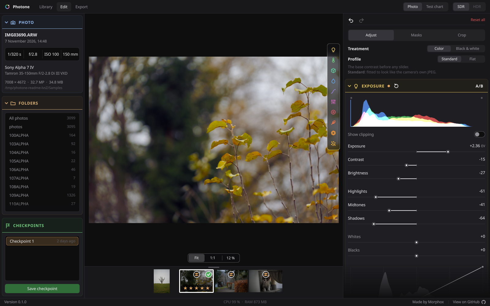
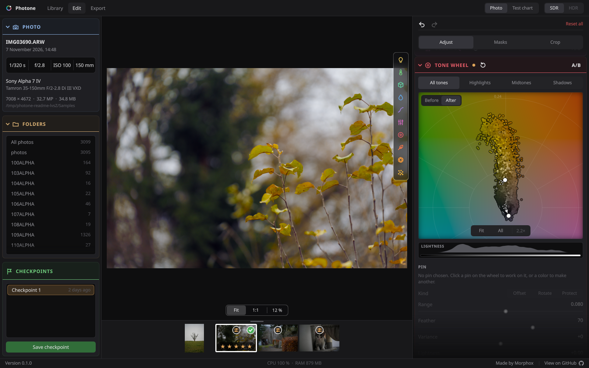
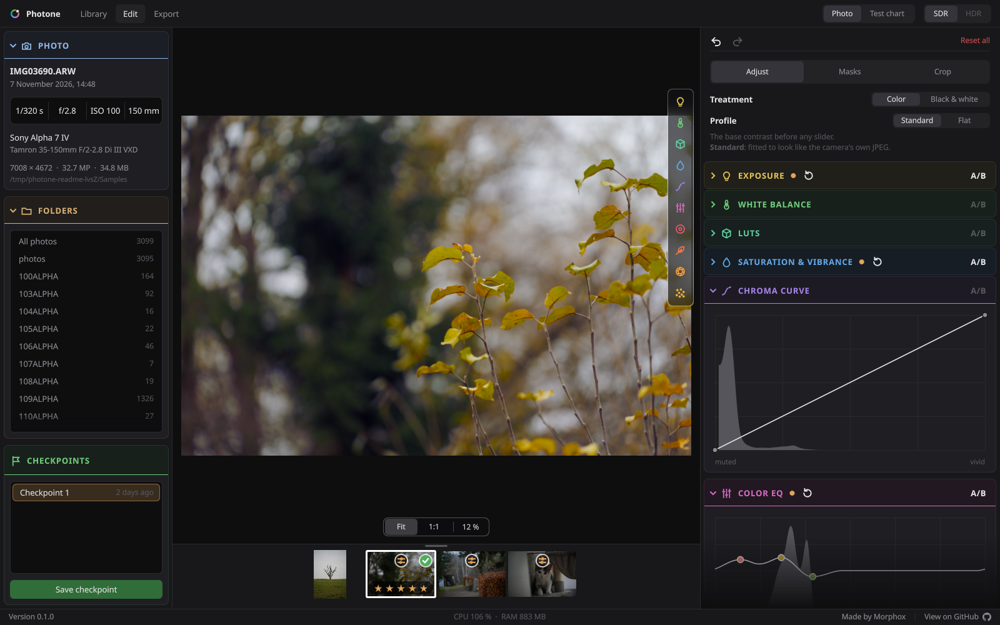
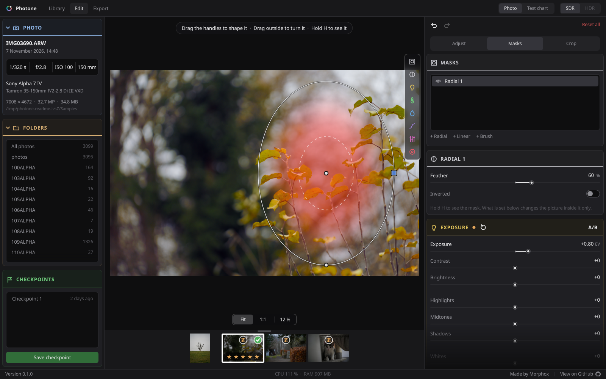
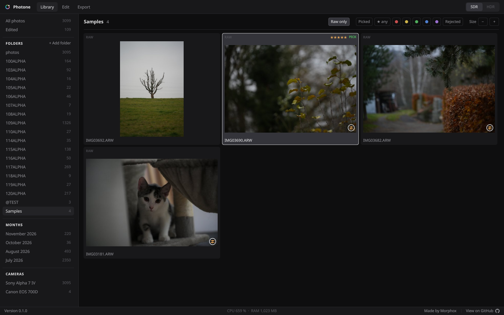
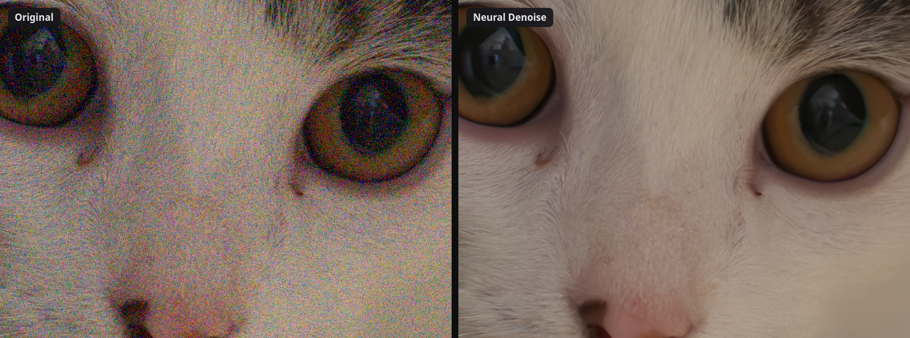
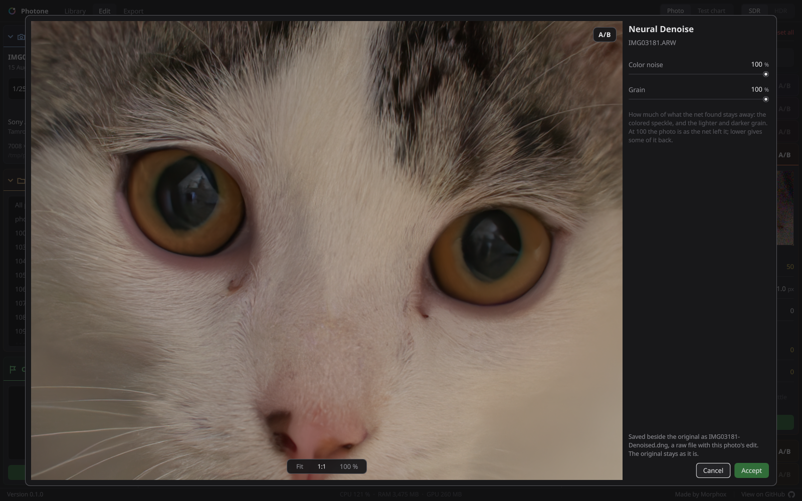

# Photone

A raw photo editor for Linux, built around a color wheel: your photo's colors show up on the
wheel, and you grade by grabbing one and moving it.

**Built to be fast and responsive.** Every adjustment runs on the GPU, so sliders, zoom and
pan answer at once, even on 33-megapixel raw files and with a folder of thousands of photos.



**Status: early, in active development.** I use it on my own photos every day, but
expect rough edges.

## What it does

- **Opens raw files** from Sony, Canon, Nikon, Fujifilm, Panasonic, Olympus/OM, Pentax and
  DNG, plus JPEG, PNG and TIFF.
- **Everything on the GPU.** Every slider is live; zoom and pan are instant.
- **Exposure and tone:** exposure, contrast, brightness, highlights, midtones, shadows,
  whites, blacks, a tone curve, and a histogram with clipping stripes.
- **Color:** white balance (a pad, kelvin sliders, pick a neutral from the photo), saturation,
  vibrance, a per-hue color EQ, a chroma curve.
- **The Tone Wheel:** click a color in the photo or on the wheel to pin it, then drag the
  pin to shift that color and those near it. Pins can be limited to highlights, midtones or
  shadows.
- **Masks:** radial, linear, or painted with a brush. Each mask has its own exposure, color
  and curve settings, and its own pins.
- **Black and white:** film looks (panchromatic, colored filters, orthochromatic) and an EQ
  that sets how light each color becomes.
- **LUTs:** install `.cube` files, stack several on a photo, each with its own strength;
  export a photo's whole look as one LUT.
- **Neural Denoise:** a neural net that takes the noise out of a raw file and writes the
  result as a new raw file (DNG) beside it. See [below](#neural-denoise).
- **Detail and lens:** sharpening, noise reduction, film grain; distortion, chromatic
  aberration and vignetting corrected from the camera's own figures in the raw file (Sony).
- **Copy and paste a look** from one photo onto others.
- **Crop, straighten, rotate.**
- **Library:** add folders (nothing is copied or moved), browse by folder, month or camera,
  pick, reject, star and label.
- **Checkpoints and undo:** save named states of an edit; undo history is kept per photo.
- **Export** to JPEG, PNG or TIFF (8 or 16 bit): the open photo from the Export page, or
  select several and right click to export them all. With a text or picture watermark if
  you want one.
- **SDR and HDR** display, switchable, where the desktop supports HDR.

Your originals are never touched. Edits live in Photone's own catalog
(`~/.local/share/photone/`).









## Neural Denoise

Photone ships its own neural denoiser: two networks of 4 million weights each (NAFNet),
trained for Photone. Either sees the photo as the sensor recorded it, in the camera's own
colors and before any edit, so what it removes is the sensor's noise rather than detail an
edit has brightened or sharpened. The **Sensor data** model takes the sensor's mosaic itself
and demosaics as it denoises; the **Developed data** model takes the photo after demosaicing.



*ISO 4000, at 100 %, both sides with the same edit.*

**Neural Denoise…** at the foot of the Detail card (or in a photo's right-click menu) opens
the photo at 100 % and runs the net on it: on the GPU (CUDA on Linux, DirectML on Windows) or
on the processor if no GPU is available. A 33-megapixel photo takes about 11 seconds on an
RTX 3080 Ti. While the result is on screen, you can:

- zoom and pan it as in Edit, and hold **A/B** to see the original;
- choose how much of the **grain** stays removed, without running the net again;
- pick the other **Model**, which runs the photo through it.

**Accept** writes `<name>-Denoised.dng` beside the original, with the photo's edit copied to
it. It is shown straight after the original in the library. The original is not changed.



The Sensor data model is the default. It takes raw files from cameras with a standard 2×2
color mosaic; other photos (Fujifilm X-Trans, say) go through the Developed data model. For
the cameras whose sensor noise has been measured, the denoiser uses those figures; for any
other camera it estimates the noise from the photo itself.

## Install and run

You need Linux (Wayland or X11), a GPU, and [uv](https://docs.astral.sh/uv/).

```sh
git clone https://github.com/TominoCZ/Photone.git
cd Photone
./run.sh                # start in the library
./run.sh photo.ARW      # or open a photo directly
./run.sh --hdr          # start in HDR, where the desktop has it
```

The first run downloads Python, Qt and the other packages. System packages are listed in
[docs/deps.md](docs/deps.md).

To have it in the desktop's menu and in "Open with", as the `photone` command:

```sh
./install.sh              # ./install.sh --uninstall takes it away again
```

### Windows

Open **Command Prompt**, paste this line and press Enter:

```bat
curl -L -o "%TEMP%\photone-install.bat" https://raw.githubusercontent.com/TominoCZ/Photone/main/install.bat && "%TEMP%\photone-install.bat"
```

It downloads Photone, builds it, installs it to `C:\Program Files\Photone` with shortcuts on the
Desktop and in the Start menu, and cleans up after itself. Nothing needs to be installed first
(Windows 10 or 11, 64-bit; Windows asks once for permission). To remove it again, use
"Installed apps" in Windows' settings.

The Windows version is new and little tested; HDR is Linux only for now.

To only build the folder without installing: `build-windows.bat` (on Windows) or
`./build-windows.sh` (on Linux) makes `bin/`, which runs as it is: start `Photone.exe` in it.
Building needs only Python 3.11 or later.

## Handy keys

| Key | Does |
|---|---|
| Ctrl+1 / 2 / 3 | Library / Edit / Export |
| ← →, A D | Previous / next photo (hold to run through them) |
| Wheel, drag | Zoom about the pointer, move the photo |
| Middle click, double click | Fit; 1:1 and back |
| B (hold) | Show the photo without its edit |
| H (hold) | Show what the chosen pin or mask covers |
| P / X / U, 1–5 | Pick / reject / clear, stars |
| Ctrl+click, Shift+click | Select several photos (library, filmstrip); right click for the menu |
| Ctrl+Z, Ctrl+Shift+Z | Undo, redo |
| Double click a slider | Reset it. Shift while dragging: finer |

## Develop

```sh
./run.sh check    # the checks
./run.sh shots    # render every screen off-screen and audit the layout
./run.sh lint     # ruff
```

## License

Photone is under the [MIT License](LICENSE).

What it uses keeps its own license: Qt and PySide6 (LGPL-3.0), LibRaw (LGPL-2.1 or CDDL-1.0)
through rawpy (MIT), NumPy (BSD-3-Clause), and the Noto Sans typeface that ships with it
([SIL Open Font License](photone/ui/fonts/OFL.txt)). The Windows build carries these as separate
files, with their license texts beside them.
